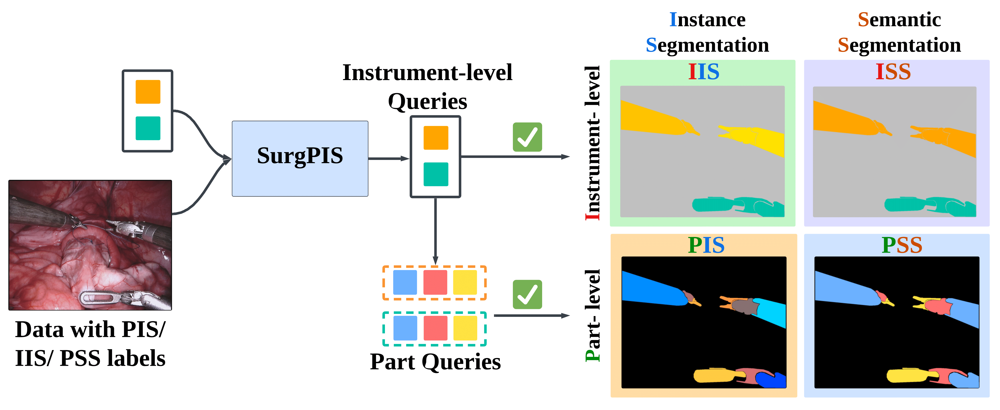
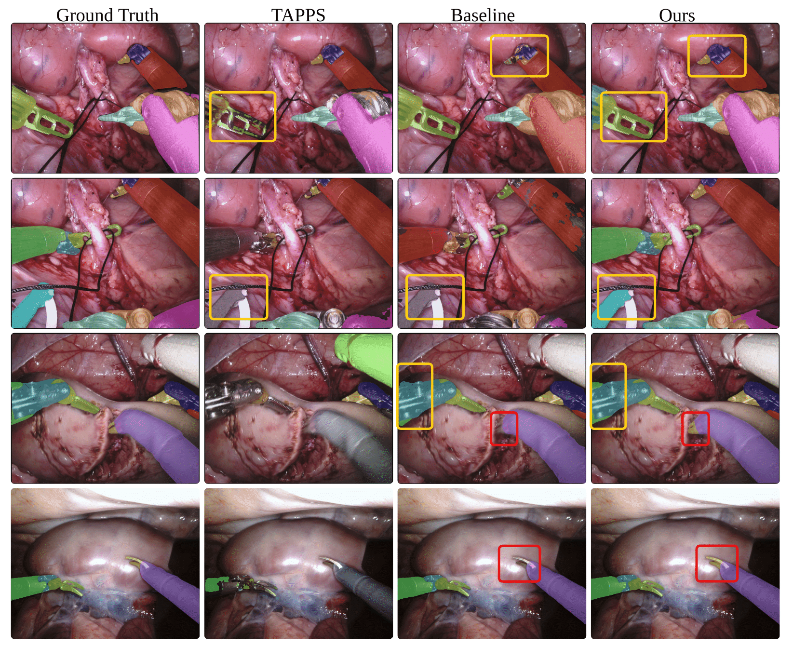

# SurgPIS: Surgical-instrument-level Instances and Part-level Semantics for Weakly-supervised Part-aware Instance Segmentation

SurgPIS unifies surgical instrument segmentation as part-aware instance segmentation, predicting individual instruments together with their part semantics.

[[Read the full paper]](https://ieeexplore.ieee.org/abstract/document/11735270/)

## News 📰

- **[November 2026]** 🎉 **Model weights are now available**!
- **[November 2026]** 🚀 The **Stage 2 (weakly supervised) code is now available**! See [Model training](#model-training) to get started.
- **[November 2026]** 🎉 Our paper has been accepted by **IEEE Transactions on Medical Imaging (TMI)**!
- **[February 2026]** 🎉 The **Stage 1 (fully supervised PIS) code is now available**!

## Introduction 📑

SurgPIS extends Mask2Former with shared part-query transformations and part-aware instance matching. It predicts instrument instances and their parts, and learns from datasets annotated at different granularities through a teacher–student model.

<div align="center">
  
</div>

## Results 🖼️

Qualitative comparisons of part-aware instance segmentation. From left to right: ground truth, TAPPS, baseline, and SurgPIS. Highlighted regions show differences in the predicted instrument instances and parts.

<div align="center">
  
</div>

## Dataset 📊

| Training stream | Dataset | Supervision |
| --- | --- | --- |
| PIS (Stages 1 and 2) | EndoVis2018 train | Instrument instances and their parts |
| IIS (Stage 2) | EndoVis2017 train | Instrument instances |
| PSS (Stage 2) | SAR-RARP50 train | Part semantics |

Validation splits are excluded from training. The expected layout is:

```text
datasets/
  EndoVis2018/
    endovis_instance_train.json
    endovis_instance_val.json
    train/images/*.png
    train/part_annotations/*.png
    val/images/*.png
    val/part_annotations/*.png
  EndoVis2017/
    endovis_instance_train.json
    endovis_instance_val.json
    train/images/*.png
    val/images/*.png
    val/part_annotations/*.png  # only needed for PIS/PartPQ evaluation
  SAR-RARP50/
    train/images/*.png
    train/annotations_pss/*.png
    test/images/*.png
    test/annotations_pss/*.png
```

Set these paths before launching training:

```bash
export ENDOVIS18_ROOT=/path/to/EndoVis2018
export ENDOVIS17_ROOT=/path/to/EndoVis2017
export SAR_RARP50_ROOT=/path/to/SAR-RARP50
```

Alternatively, place these directories under `datasets/`, or set `DETECTRON2_DATASETS`. See [dataset preparation](docs/DATASETS.md). Defaults use EndoVis18 **train** for PIS, EndoVis17 **train** for IIS, and SAR-RARP50 **train** for PSS. Validation is excluded from training. These sources must contain disjoint images; changing catalog names alone does not guarantee disjointness.

## How to Run the Code 🛠

### Environment installation

The codebase builds on Detectron2 and Mask2Former. Follow [install.md](install.md); a [Dockerfile](Dockerfile) is also provided. Dataset files and model weights are not bundled with this source repository.

## Model training

### Stage 1: fully supervised PIS

```bash
NUM_GPUS=2 bash stage1.sh
```

### DINO-B and Swin-B

The same scripts support DINOv2 ViT-B/14 and Swin-B. Their defaults use explicit tissue background. Stage 1 uses only EndoVis18 **train** PIS; Stage 2 retains this PIS stream and adds EndoVis17 **train** IIS and SAR-RARP50 **train** PSS. Prepare the PSS masks as described in [dataset preparation](docs/DATASETS.md).

DINO-B downloads its pretrained backbone through `torch.hub` before launching distributed training:

```bash
BACKBONE=dinob NUM_GPUS=2 bash stage1.sh
BACKBONE=dinob NUM_GPUS=2 bash stage2.sh
```

For Swin-B, download and convert the pretrained ImageNet-22K backbone once:

```bash
mkdir -p weights
curl -fL https://github.com/SwinTransformer/storage/releases/download/v1.0.0/swin_base_patch4_window12_384_22k.pth \
  -o weights/swin_base_patch4_window12_384_22k.pth
python tools/convert-pretrained-swin-model-to-d2.py \
  weights/swin_base_patch4_window12_384_22k.pth \
  weights/swin_base_patch4_window12_384_22k.pkl
BACKBONE=swinb NUM_GPUS=2 bash stage1.sh
BACKBONE=swinb NUM_GPUS=2 bash stage2.sh
```

Outputs are `output/stage1_dino_b`, `output/stage2_dino_b`, `output/stage1_swin_b`, and `output/stage2_swin_b`. Stage 2 automatically selects the matching Stage-1 final checkpoint; use `STAGE1_CHECKPOINT=/path/to/checkpoint.pth` to select another checkpoint with the same architecture and label formulation. Use `RESUME=1` with the same backbone and output directory to resume.

Both backbones inherit the standard 40,000-step schedule, batch size 16, IIS/PSS weights 2.0/3.0, and EMA decay 0.9996. Validation sets and EndoVis17 PIS are excluded from these training defaults.

### Stage 2: weak supervision from IIS and PSS

```bash
NUM_GPUS=2 STAGE1_CHECKPOINT=output/stage1/model_final.pth bash stage2.sh
```

The student and teacher both load the stage-1 trained weights. The teacher uses EMA with decay 0.9996 and no burn-in. Each step includes a supervised PIS batch; weak steps alternate IIS and PSS batches. Both weak streams also apply teacher PIS consistency losses.

The default ResNet-50 configurations use 40,000 training steps and a total batch size of 16. You can override the settings at launch:

```bash
OUTPUT_DIR=output/stage1_custom bash stage1.sh SOLVER.IMS_PER_BATCH 4 SOLVER.MAX_ITER 40000
RESUME=1 bash stage2.sh
```

`BACKBONE`, `CONFIG`, `NUM_GPUS`, `PYTHON`, `OUTPUT_DIR`, and `RESUME` are environment overrides. Resuming restores model, optimizer, scheduler, iteration and AMP state from that output directory. GPU count does not automatically change the total batch size.

## Model evaluation

### Released model weights

| Stage | Backbone / model | Hugging Face | Download |
|---|---|---|---|
| 1 | RN50 | [SurgPIS-Stage1-RN50](https://huggingface.co/oliviamw/SurgPIS-Stage1-RN50) | [Weights](https://huggingface.co/oliviamw/SurgPIS-Stage1-RN50/resolve/main/surgpis_stage1_rn50.pth) |
| 1 | DINO-B (DINOv2 ViT-B/14) | [SurgPIS-Stage1-DINOv2-Base](https://huggingface.co/oliviamw/SurgPIS-Stage1-DINOv2-Base) | [Weights](https://huggingface.co/oliviamw/SurgPIS-Stage1-DINOv2-Base/resolve/main/surgpis_stage1_dinov2_base.pth) |
| 2 | RN50 Teacher | [SurgPIS-Stage2-RN50-Teacher](https://huggingface.co/oliviamw/SurgPIS-Stage2-RN50-Teacher) | [Weights](https://huggingface.co/oliviamw/SurgPIS-Stage2-RN50-Teacher/resolve/main/surgpis_stage2_rn50_teacher.pth) |
| 2 | RN50 Student | [SurgPIS-Stage2-RN50-Student](https://huggingface.co/oliviamw/SurgPIS-Stage2-RN50-Student) | [Weights](https://huggingface.co/oliviamw/SurgPIS-Stage2-RN50-Student/resolve/main/surgpis_stage2_rn50_student.pth) |

All releases contain standalone model weights only, without optimizer state. They use explicit tissue background (`NUM_CLASSES: 10`, plus the no-object output). RN50 releases use `stage1_R50_pretrained.yaml`; DINO-B additionally requires `DinoV2BaseBackbone`. The evaluation helper below is specific to the released Stage-1 RN50 checkpoint.

### Continue training from Stage-1 weights

To continue Stage 1 from a released RN50 checkpoint, download it from [Released model weights](#released-model-weights) and use the matching explicit-tissue config:

```bash
CONFIG=configs/endovis/instance-part-segmentation/stage1_R50_pretrained.yaml \
OUTPUT_DIR=output/stage1_finetuned \
bash stage1.sh MODEL.WEIGHTS /path/to/surgpis_stage1_rn50.pth
```

To train Stage 1 from scratch, follow the [Stage 1 training instructions](#stage-1-fully-supervised-pis).

### Evaluate Stage-2 weights

Use the Stage-2 RN50 Teacher or Student checkpoint from [Released model weights](#released-model-weights). Set the EndoVis dataset paths first. For PartPQ evaluation on both validation sets, run:

```bash
python tools/audit_partpq_tapps.py \
  --reference tools/reference_tapps/evaluation_PartPQ.py \
  --checkpoint /path/to/surgpis_stage2_rn50_teacher.pth --model TEACHER --offsets 0 \
  --datasets endovis_inp_val endovis17_inp_val --output-dir output/stage2_partpq
```

Use the Student checkpoint with `--model STUDENT` to evaluate that branch. EndoVis17 PartPQ requires its part annotations.

Stage 1 stores its trained model under the `TEACHER` checkpoint slot; this is not an EMA teacher. Stage 2 stores both `TEACHER` and `STUDENT`.

```bash
python train_net.py --config-file configs/endovis/instance-part-segmentation/stage1_R50.yaml \
  --eval-only --num-gpus 1 MODEL.WEIGHTS output/stage1/model_final.pth \
  WSL.EVAL_WHO TEACHER DATASETS.TEST "('endovis_inp_val',)"
```

For TAPPS-adapted PartPQ on classes with available parts:

```bash
python tools/audit_partpq_tapps.py \
  --reference tools/reference_tapps/evaluation_PartPQ.py \
  --checkpoint output/stage2/model_final.pth --model TEACHER --offsets 0 \
  --datasets endovis_inp_val endovis17_inp_val --output-dir output/partpq
```

EndoVis17 PartPQ evaluation additionally requires part annotations; IIS-only training does not. Do not use the legacy `-1` class offset for newly trained checkpoints. The ordinary dataset evaluators and TAPPS-adapted PartPQ are different metrics.

## Repository structure

The code is organized into `surgpis_config/`, `configs/`, `mask2former/`, `modules/`, `tools/`, `demo_inspart/`, and `Figures/`. `surgpis_config/` contains Python configuration definitions; `configs/` contains YAML model and training recipes. Training options use the `WSL` configuration namespace.

- `stage1.sh`: fully supervised PIS training.
- `stage2.sh`: PIS + IIS + PSS training initialized from stage 1.
- `train_net.py`: training and evaluation entry point.
- `docs/DATASETS.md`: expected files and label conventions.

## Citation 📖

If you find SurgPIS useful, please cite our work:

```bibtex
@article{wei2026surgpis,
  title={SurgPIS: Surgical-instrument-level Instances and Part-level Semantics for Weakly-supervised Part-aware Instance Segmentation},
  author={Wei, Meng and Budd, Charlie and Alabi, Oluwatosin and Shi, Miaojing and Vercauteren, Tom},
  journal={IEEE Transactions on Medical Imaging},
  year={2026},
  publisher={IEEE}
}
```

## Acknowledgements

This implementation builds on Mask2Former and Detectron2. Original source headers and license files are retained. The TAPPS-adapted reference evaluator is in `tools/reference_tapps/`.
